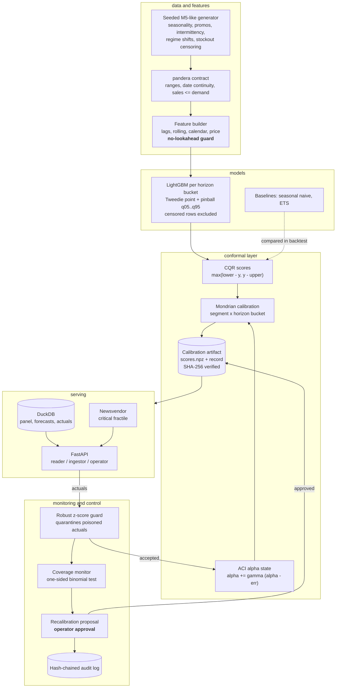

# conformal-demand-forecaster

A demand forecaster that reports not only how much it thinks you will sell, but how wrong it
might be — and keeps that second promise when the market moves underneath it.

## The problem

"We will sell 40 units" is not an order. A planner buying stock needs a range with a promise
attached to it: *between 12 and 68, and a range like this contains the real number 95 times out
of 100.* Given that range, plus what a unit costs to hold and what a stockout costs, an order
quantity follows.

Those ranges are usually computed once, when the model is trained, and then trusted indefinitely.
Demand does not cooperate. A promotion calendar changes, a competitor closes, a category is
re-priced — and the range that was honest last quarter is now too narrow. It still carries the
label "95%".

The failure is quiet, which is what makes it expensive. A wrong point forecast is visibly wrong.
A wrong range looks exactly like a correct one. The bill arrives twice: stockouts during the
shift, on the items customers actually wanted, and dead inventory after it — while the planner
keeps trusting the number that caused both. Nothing in an ordinary forecasting stack notices, and
nothing raises a hand.

This repository measures that failure and then fixes it. In `bench/bench_shift.py`, a model
frozen before a 2.2x demand shift keeps printing "95%" intervals whose real coverage over the
next 200 days is **80.4%** — fifteen points of broken promise. The adaptive layer here holds
**94.3%** over the same days, and the monitor raises an alarm either way.

## What this does

- **Puts a tested promise on every range.** Each forecast comes back as a range with a coverage
  level, and that level is verified against what actually happened instead of assumed.
- **Notices when the promise breaks.** A statistical test runs daily over the last 28 days, for
  each product group. On the benchmark it catches a genuine break in a median of 9 days and
  raises a false alarm in 4 of 1,000 calm runs.
- **Adapts in days, not quarters.** When misses start accumulating, tomorrow's ranges widen on
  their own. The shift is absorbed before anyone retrains a model.
- **Turns the range into an order quantity.** With holding cost 1 and stockout cost 4, ordering
  from the ranges cost about 18% less than ordering the point forecast on the same backtest.
- **Refuses to rewrite its own promise without a person.** The automatic widening is temporary
  and reversible. Permanently re-fitting the ranges requires a human approval, recorded in a log
  that cannot be edited without breaking it.

Two terms appear throughout and are worth six words each. **Coverage** is the share of days the
real number fell inside the range. **Calibration** is the stored evidence that sets range widths.

## Architecture



### How a day flows through it

1. **The batch runs.** The trainer reads the sales panel, builds features that may only look
   backwards, and fits LightGBM point and quantile models per horizon bucket.
2. **The promise is measured, not assumed.** The models forecast a 56-day window that training
   never saw. Each forecast is scored against what really happened, and those scores are frozen
   into a *calibration artifact* — grouped by (demand segment x horizon bucket), hashed, and
   given a version.
3. **Forecasts are written.** Each series gets a point forecast and, per level, a range whose
   width is read off its own group's frozen scores. They land in DuckDB.
4. **A planner asks.** `GET /v1/forecast/S0001_ST01?horizon=7` with a reader key returns the
   point forecast, the ranges, the calibration version and the order quantity.
5. **Reality arrives.** `POST /v1/actuals` with an ingestor key. Every record passes the data
   contract, then an outlier guard. Values that look implanted are quarantined and go no further
   — not into the panel, not into the calibration, not into the monitor.
6. **The promise is scored.** Accepted actuals are compared against the ranges that were served
   for that day. Each group's miss rate nudges its effective miscoverage level (tomorrow's ranges
   widen or narrow) and enters its rolling 28-day monitor window.
7. **Possibly an alarm.** If the binomial test says coverage genuinely broke, one proposal opens
   per (segment, level) and waits. A sustained breach produces one thing to decide, not a daily
   stream.
8. **A person decides.** Only an operator key can approve. Approval merges the recent scores into
   the frozen set and promotes a new calibration version. The decision, the approver and both
   version digests are appended to a hash-chained audit log.

Steps 6 and 8 run at deliberately different speeds. The **fast loop** (step 6) is automatic,
bounded, reversible, and changes no stored file. The **slow loop** (step 8) is the only
irreversible action in the system, which is why it is the only one that needs a human
([ADR 0005](docs/adr/0005-approval-gated-recalibration.md)).

Everything runs offline on CPU. The data comes from a seeded generator; no test, demo or
benchmark calls a paid API.

## Results

Numbers below are the recorded contents of `bench/results/*.json`, measured on Windows 10
(10.0.19045), Intel64 Family 6 Model 158, 6 logical CPUs, Python 3.12.14, CPU only. The `runtime`
column is each script's own recorded `seconds`. CI re-runs the same scripts against the looser
limits in `bench/thresholds.json` (`.github/workflows/ci.yml#bench`).

| what it measures | command | runtime |
|---|---|---|
| accuracy, coverage, decisions | `uv run python bench/bench_backtest.py --series 200` | 225 s |
| behaviour under a regime shift | `uv run python bench/bench_shift.py` | 1.1 s |
| the coverage guarantee in isolation | `uv run python bench/bench_conformal.py` | 0.08 s |
| the monitor's alarm characteristics | `uv run python bench/bench_monitor.py` | 9.2 s |
| hot-path timings | `uv run python bench/bench_baseline.py` | — |

### Accuracy and calibration

200 series, 1,096 days, 12 rolling origins, 28-day horizon, 67,200 forecasts scored against
latent true demand.

| model | MASE | weighted scaled pinball | coverage 80% | coverage 95% |
|---|---|---|---|---|
| **conformal GBM** | **0.8099** | **0.1901** | **0.7999** | **0.9532** |
| seasonal naive | 1.0487 | 0.2722 | 0.8055 | 0.8882 |
| ETS | 0.8891 | 0.2185 | 0.7768 | 0.8762 |

Reading the table:

- **MASE** is average error divided by the error of a simple "same weekday last week" rule.
  Lower is better. 0.8099 against that rule's own 1.0487 is 23% less error (recorded as
  `mase_ratio_vs_snaive` 0.77232); against ETS it is 9% less.
- **Weighted scaled pinball** scores the whole set of quantiles, not just the middle. 0.1901
  against 0.2722 is 30% lower than seasonal naive, 13% lower than ETS.
- **Coverage** is the promise. The 80% range covered 79.99% of the 67,200 days and the 95% range
  covered 95.32% — off by 0.006 and 0.32 of a percentage point. The two baselines' ranges are
  plain residual quantiles with no promise attached, and their 95% ranges cover only 88.8% and
  87.6%: 6.2 and 7.4 points short. That gap is the failure this repository exists to remove.

Which part of the design earns that coverage:

| level | method | coverage | width | Winkler | worst-segment gap |
|---|---|---|---|---|---|
| 80% | mondrian | 0.7999 | 17.05 | 24.55 | **0.0082** |
| 80% | pooled | 0.8004 | 16.75 | 24.54 | 0.0249 |
| 80% | aci | 0.7993 | 16.98 | 24.57 | 0.0021 |
| 80% | raw (no conformal step) | 0.7774 | 16.71 | 24.54 | 0.0397 |
| 95% | mondrian | 0.9532 | 24.66 | 35.67 | **0.0035** |
| 95% | pooled | 0.9532 | 24.35 | 35.56 | 0.0188 |
| 95% | aci | 0.9500 | 24.38 | 35.79 | 0.0007 |
| 95% | raw (no conformal step) | 0.9008 | 21.35 | 37.50 | 0.0607 |

`raw` is the same LightGBM quantile pair with the conformal step removed. It separates "the
conformal layer helped" from "the gradient-boosted model was already good": raw is 2.3 points
short at 80% and 4.9 at 95%, with roughly five to seventeen times the worst-segment gap. On the
20-series CI configuration, where each group has fewer scores to calibrate from, raw falls 12.5
points short at 80%.

Pooled and Mondrian reach the same *average* coverage, so the average is the wrong thing to look
at. The difference is the **worst-segment gap** — how far the worst-served group sits from the
others. Pooled leaves 2.5 points of spread between smooth and intermittent products at 80%;
Mondrian leaves 0.8, for about 2% more width
([ADR 0004](docs/adr/0004-mondrian-segment-horizon-groups.md)). In plain terms: pooling makes the
promise true on average while quietly breaking it for slow-moving items.

### Behaviour under a regime shift

A model trained and frozen before a 2.2x level shift, then scored over the following 200 days
with no retraining and no recalibration. This is the scenario from the top of this README.

| level | method | coverage before | coverage after | width after |
|---|---|---|---|---|
| 80% | frozen split conformal | 0.8411 | **0.6847** | 21.63 |
| 80% | ACI | 0.8214 | **0.7897** | 30.34 |
| 95% | frozen split conformal | 0.9409 | **0.8038** | 29.75 |
| 95% | ACI | 0.9381 | **0.9430** | 51.55 |

The frozen calibration ends 11.5 and 14.6 points below nominal: a range labelled 95% that in
practice contains the answer 8 times in 10. ACI holds to within 1.03 and 0.70 points, and pays
for it in width — about 1.4x and 1.7x the frozen ranges, which the ordering layer then pays for
in stock. The target set for this repository was a long-run coverage error under 1 point: met at
95% (0.70pp), missed by 0.03pp at 80% in the shipped configuration. The shipped `gamma = 0.08`
comes from the measured sweep in [ADR 0003](docs/adr/0003-adaptive-conformal-inference.md), not
from taste.

### The coverage guarantee, in isolation

500 independent exchangeable splits, 200 calibration points each. This checks the mathematics
directly, away from any retail data.

| level | measured coverage | lower bound | upper bound |
|---|---|---|---|
| 80% | 0.7960 | 0.7463 | 0.8586 |
| 95% | 0.9340 | 0.9208 | 0.9842 |

The bounds are the theoretical bracket `[1-alpha, 1-alpha + 1/(n+1)]`, widened by a 3-sigma
binomial tolerance for 500 splits. Measured coverage lands inside both.

The same script isolates the Mondrian effect on two synthetic groups whose noise differs by 6x.
Pooled calibration covers them 0.878 and 0.760 — a 7.8-point spread around a nominal 0.80 that
the pooled average reports as healthy. Per-group calibration gives 0.796 and 0.822: 2.2 points.

### Monitor operating characteristic

500 stationary simulations, 500 breach simulations (miss rate 0.35 against a nominal 0.20) and
500 over-coverage simulations (miss rate 0.05), 90 days each, 28-day window, significance 0.01.

| metric | value | what it means |
|---|---|---|
| false alarms, share of stationary runs | 0.004 | 4 of 1,000 calm 90-day runs cried wolf |
| detection delay after a genuine breach, median | 9 days | half of real breaches caught within 9 days |
| detection delay, p90 | 12 days | 9 in 10 caught within 12 days |
| breaches never detected inside the window | 0.000 | none slipped through |
| over-coverage false alarms | 0.000 | the second arm stayed quiet on calm runs |
| over-coverage detection delay, median | 13 days | systematically-too-wide ranges found in 13 days |
| over-coverage never detected | 0.000 | none slipped through |

The second arm watches the opposite failure. Ranges wider than their level requires are not a
broken promise, but they are holding cost, and the ordering layer prices them. Only a breach
opens a recalibration proposal; over-coverage is reported and counted.

### Decisions

Ordering at holding cost 1 and stockout cost 4, on the same 200-series backtest. Cost is the
mean realized newsvendor cost per forecast — holding cost on every unit left over plus
stockout cost on every unit short. Lower is better.

| ordering policy | realized cost |
|---|---|
| **conformalized quantiles** | **11.77** |
| point forecast | 14.43 |
| median forecast | 16.32 |

Ordering from the calibrated ranges costs about 18% less than ordering the point forecast. This is
the line that connects the statistics to money: the uncertainty is only worth computing if it
reaches the decision.

### Hot paths

Microseconds per call. p50 is the typical call; p95 means 19 of every 20 calls finished at or
under that time.

| benchmark | p50 (us) | p95 (us) |
|---|---:|---:|
| conformal_quantile_5k_scores | 31.3 | 35.7 |
| cqr_scores_5k_rows | 14.3 | 16.2 |
| newsvendor_orders_5k_rows | 207.8 | 219.9 |
| monitor_status_28_days | 148.1 | 191.1 |
| aci_update | 0.6 | 0.7 |
| outlier_guard_check | 106.4 | 129.9 |

These are single-machine numbers for catching regressions, not performance claims.

## How it works

### Components

| layer | what it is | where |
|---|---|---|
| Data | Seeded generator: 200 SKU-store series, 3 years daily, seasonality, price elasticity, promotions, intermittency, scheduled regime shifts, stockout censoring. Latent demand is retained for scoring. | `data/`, `ml/contracts.py` |
| Features | Lag, rolling, calendar and price features with a hard no-lookahead rule. | `features/` |
| Models | LightGBM per horizon bucket: Tweedie point plus pinball quantiles at 0.05, 0.1, 0.5, 0.9, 0.95. Seasonal-naive and ETS baselines. | `models/` |
| Conformal | CQR scores, Mondrian grouping, ACI alpha state, hashed and versioned artifacts. | `conformal/` |
| Decisions | Newsvendor order from the critical fractile of the conformalized quantile function. | `decisions/` |
| Serving | DuckDB store, forecasting runtime, role-based FastAPI, outlier guard. | `serving/` |
| Control | Coverage monitor, recalibration workflow, hash-chained audit log, metrics. | `monitoring/` |

The interval layer is **conformalized quantile regression** (CQR; Romano, Patterson and Candes,
2019): score `s = max(lower - y, y - upper)` on held-out forecasts, then widen the model's own
quantile pair by the `ceil((n+1)(1-alpha))`-th smallest score. The guarantee is finite-sample and
distribution-free, and unlike absolute-residual split conformal it preserves the asymmetric shape
the quantile model learned ([ADR 0002](docs/adr/0002-conformalized-quantile-regression.md)).

Calibration is **Mondrian**: separate score sets per (segment x horizon bucket), six groups per
level. A group with fewer than 50 scores falls back to the pooled set and says so on the result,
rather than serving a 95% quantile read off three points
([ADR 0004](docs/adr/0004-mondrian-segment-horizon-groups.md)).

Under shift, **Adaptive Conformal Inference** (Gibbs and Candes, 2021) treats the miscoverage
level as a control variable: `alpha_{t+1} = alpha_t + gamma (alpha - err_t)`, one state per
(segment, horizon bucket, level), updated daily from realized misses
([ADR 0003](docs/adr/0003-adaptive-conformal-inference.md)).

### The key trade-off

Coverage under shift is bought with width. ACI restores the promise by widening — about 1.4x at
80% and 1.7x at 95% after the benchmark's shift — and wider ranges mean larger orders, so the
ordering layer pays the bill for the statistics. That is the intended direction: a range that is
too wide is a measurable holding cost, while a range that is silently too narrow is an unpriced
error. The monitor's second arm exists so the over-wide case is at least visible.

### Why this and not the obvious alternative

The obvious alternative to conformalizing is to train LightGBM at q=0.05 and q=0.95 and call the
pair a 90% range. It is cheaper, and it is what most stacks do. The `raw` rows above are exactly
that, measured: 2.3 and 4.9 points short on the 200-series backtest, 12.5 points short at 80% on
the smaller CI configuration, with up to seventeen times the worst-segment gap. Quantile
regression gives whatever coverage the optimizer happened to reach on the training distribution.
Conformalizing turns that into a checked property.

The alternative to ACI is to reweight recent calibration scores — the principled version being
weighted conformal prediction (Barber et al., 2023). It is discussed and rejected with reasons in
ADR 0003 rather than waved away: its bound degrades with an unknown total-variation distance, the
weighting rule is another per-group parameter to defend, and ACI reaches long-run coverage here
with one parameter this repository could actually measure.

The alternative to approval-gated recalibration is to recalibrate automatically on every alarm.
That is also the cheapest way to turn a data-quality incident into an outage: a breach can mean a
real shift (recalibrate), a known holiday (do not bake it into the permanent calibration), or
poisoned actuals that slipped the guard (recalibrating is precisely the attacker's goal). ADR 0005
splits the response so the automatic half stays bounded and reversible, and only the permanent
half waits for a person.

### Layout

```text
src/conformal_demand_forecaster/
  core/        settings, redacting logs, tracing, metrics, hardened FastAPI factory
  ml/          pandera contracts, run manifest, model registry, drift, safe serialization
  data/        seeded generator, wide-array panel
  features/    no-lookahead feature builder
  models/      LightGBM quantile models, seasonal-naive and ETS baselines
  conformal/   CQR scores, Mondrian calibrator, ACI state, versioned artifacts
  evaluation/  rolling-origin backtest, metrics, bench reporting
  decisions/   newsvendor order quantities
  monitoring/  coverage monitor, recalibration workflow, audit chain, metrics
  serving/     DuckDB store, forecasting runtime, role-based API, outlier guard
bench/         baseline, conformal, monitor, shift, backtest (all with thresholds)
tests/unit, tests/integration
docs/THREAT_MODEL.md  docs/adr/  CLAIMS.md  MODEL_CARD.md
```

## Security

The asset worth protecting here is unusual. It is not the model — a wrong model produces visibly
wrong forecasts and somebody complains. It is the **calibration**: the stored evidence that sets
every range width. Change it quietly and the service keeps answering with the same authority while
mis-sizing every order, and the only symptom is a coverage number nobody was watching. Most of the
controls below protect that file and the record of who changed it.

Threats, controls and the tests that prove them are in
[docs/THREAT_MODEL.md](docs/THREAT_MODEL.md); every claim in this README maps to evidence in
[CLAIMS.md](CLAIMS.md).

- **Three roles, no overlap.** *Plainly:* the account that feeds in sales data cannot approve a
  change, and the account that approves changes cannot feed in data. *Mechanism:* API-key authn
  with reader, ingestor and operator roles; each endpoint demands exactly one. Keys are stored
  only as SHA-256 digests and compared in constant time against every configured digest.
  Protected routes fail closed when no keys are configured.
- **No silent self-modification.** *Plainly:* the system can propose re-fitting its own ranges but
  cannot do it alone, and the record of who agreed cannot be quietly edited. *Mechanism:* an alarm
  opens a proposal; only an operator can approve; only an approved proposal can be applied. Every
  transition is appended to a hash-chained audit log naming the actor, the approver and both
  calibration versions. The proposal file is a projection of that chain, not the authority —
  before any transition the workflow replays the chain and refuses when the two disagree, so
  editing the file cannot resurrect a rejected proposal or forge an approver.
- **History is append-only.** *Plainly:* yesterday cannot be rewritten to make the forecast look
  better. *Mechanism:* an ingested day must fall inside the window the service actually serves
  (panel start to last observed day plus the forecast horizon) and is rejected outside it. A day
  the panel already holds is never rewritten, never re-scored, and is audited as a duplicate —
  recorded sales are the guard's own reference window and, after a promotion, the calibration
  scores.
- **Resistance to poisoned data.** *Plainly:* somebody who can submit sales figures should not be
  able to distort every range by submitting one fake spike. *Mechanism:* actuals pass the data
  contract, then a robust median/MAD guard with a Poisson-like floor anchored on the 90th
  percentile. Quarantined values are stored for review and never reach the ACI state, the monitor
  or the panel. The guard is one-sided, so a genuine collapse to zero demand still reaches the
  monitor, and one poisoned point in a series' history cannot disarm it — a mean/standard-deviation
  screen would wave the next spike straight through.
- **Artifacts are verified, never trusted.** *Plainly:* if a file on disk is edited, the service
  refuses to serve rather than serving something wrong. *Mechanism:* the calibration version is
  the SHA-256 of its canonical record, which carries the digests of the score and reference files;
  all are verified on load, and an alpha state belonging to another calibration — or written under
  a step size the configuration did not choose — is refused. Models are content-addressed in the
  registry. Nothing is pickled: LightGBM text, JSON, and npz with `allow_pickle=False`.
- **No looking at the future.** *Plainly:* a model that accidentally peeks at tomorrow looks
  brilliant in testing and fails in production. *Mechanism:* a feature row may read the panel only
  up to its origin, plus the target day's known-in-advance covariates. Tests perturb the future
  for arbitrary origins and horizons and assert every row is byte-for-byte unchanged. A leak here
  would inflate accuracy and silently destroy the coverage guarantee.
- **Request hygiene.** Pattern-validated series ids, bounded horizons and costs, capped batch
  sizes, parameterised SQL, token-bucket rate limiting, body-size limits, security headers and
  strict CORS. Errors carry fixed codes and never echo exception text or submitted values; logs,
  tracebacks and audit payloads pass through PII and secret redaction. Contract violations report
  (column, check, count) without copying the rejected values.
- **No personal data.** The panel holds SKU-store identifiers, units, prices and flags.
- **CI.** ruff, mypy --strict, pytest with an 85% line-and-branch coverage floor, bandit, semgrep
  with repository rules, pip-audit, gitleaks, hadolint, a trivy image scan and a syft CycloneDX
  SBOM. Base images are pinned by digest. See [SECURITY.md](SECURITY.md) for reporting.

## Quickstart

Requirements: [uv](https://docs.astral.sh/uv/) and Python 3.12. No API key, no network, no paid
service.

```bash
uv sync --frozen
uv run python tasks.py demo    # the whole story offline, JSON summary on stdout
uv run python tasks.py check   # ruff, mypy --strict, pytest + coverage, bandit, pip-audit, baseline
uv run python tasks.py bench   # five benches with regression thresholds
```

On Windows, keep the environment off a small repository drive:
`$env:UV_PROJECT_ENVIRONMENT = "C:/Users/<you>/.venvs/conformal-demand-forecaster"`.

### What the demo shows you

`tasks.py demo` generates 24 series with a level shift on a known day, trains and calibrates
*before* the shift, then streams all 70 post-shift days in as actuals — one adversarial spike
included — and reports how the frozen and adaptive ranges held up:

```json
{
  "backtest_coverage_80_mondrian_pre_shift": 0.7991,
  "static_coverage_80_post_shift": 0.7815,
  "aci_coverage_80_post_shift": 0.8018,
  "static_scored_post_shift": 1680,
  "aci_scored_post_shift": 1680,
  "first_alarm_day_after_shift": 4,
  "quarantined_actuals": 3,
  "pending_proposals": ["b5d6afbd81ef44c2861107db1ede1b82", "a017ea894e914a5fb305a93a65e6d412"],
  "audit_chain_ok": true,
  "seconds": 30.5
}
```

Read it as a short story. The calibration was honest before the shift (79.91% on a nominal 80%).
Afterwards the frozen ranges slipped to 78.15% while the adaptive ones held 80.18%, both measured
over the same 1,680 one-day-ahead intervals. The monitor raised its alarm on the fourth day after
the shift. The injected spike was quarantined before it could widen anything. Two proposals sit
unapplied, waiting for an operator who does not exist in a demo.

The workdir is recreated on every run, so a second run prints the same coverage, the same alarm
day and the same quarantine count. The proposal ids, the MLflow run id, the model and calibration
digests and the timing change between runs.

### Running the pipeline yourself

```bash
uv run conformal-demand-forecaster generate --out var/panel.csv --n-series 200
uv run conformal-demand-forecaster train --panel var/panel.csv --data-dir var
uv run conformal-demand-forecaster backtest --panel var/panel.csv --n-origins 12
uv run conformal-demand-forecaster audit verify --data-dir var
```

### Serving it

Keys are generated once and stored only as digests, one list per role:

```bash
uv run conformal-demand-forecaster generate-api-key     # prints the key and its SHA-256
APP_READER_KEY_SHA256=<digest> uv run conformal-demand-forecaster serve
curl -s -H "X-API-Key: <key>" "http://127.0.0.1:8000/v1/forecast/S0001_ST01?horizon=7"
```

```json
{
  "series_id": "S0001_ST01", "horizon": 7, "segment": "smooth",
  "point": 4.153, "median": 3.476,
  "intervals": {
    "80": {"lower": 0.304, "upper": 7.895,  "alpha_effective": 0.1394, "saturated": false},
    "95": {"lower": 0.0,   "upper": 12.349, "alpha_effective": 0.0360, "saturated": false}
  },
  "calibration_version": "b401271240679973...",
  "model_version": "2d05deaa999e973e...",
  "order": {"fractile": 0.8, "fractile_served": 0.8, "fractile_clipped": false,
            "quantity": 6.790, "units": 7}
}
```

That response is the demo's `example_forecast` field, from the same `get_forecast` call the route
serves. The two version strings are content digests and depend on the local build, so yours will
differ. The other fields are worth knowing:

- `alpha_effective` sits below its nominal 0.2 and 0.05 because ACI has widened this group since
  the shift.
- `saturated` says whether the calibration set was exhausted. That is the point at which the
  guarantee stops being trustworthy, so it is reported rather than hidden.
- `fractile_clipped` says whether the cost ratio asked for a quantile beyond the outermost
  calibrated one — above 39:1 here, which saturates at the 97.5% bound — in which case
  `fractile_served` is the fractile the order was really read off.

A forecast is only meaningful as the pair `(model_version, calibration_version)`. Either one
changing changes what the numbers mean.

### Containers

`docker compose up --build` runs the non-root, read-only image (uid 10001, `cap_drop: ALL`,
`no-new-privileges`, one writable volume at `/var/lib/forecaster`). A fresh volume holds no model,
so the service starts and answers `/healthz` while `/readyz` reports `not_ready`; run
`docker compose run --rm app train --panel ... --data-dir /var/lib/forecaster` to install one.

The image build, its HEALTHCHECK, hadolint, the trivy scan and the syft SBOM run in CI
(`.github/workflows/ci.yml#docker`), not locally — recorded as CI-only evidence in CLAIMS.md.

## Non-goals

- **Per-series coverage.** The guarantee is marginal within a calibration group (segment x horizon
  bucket), not per SKU and not conditional on covariates. A single slow mover can be badly covered
  while its segment is fine. Closing this needs either per-series calibration — not enough scores
  per series at a 56-day window — or a conditional method such as localized conformal prediction.
- **Finite-sample guarantees under shift.** ACI's bound is long-run, says nothing about any given
  day, and its premise fails when the calibration set saturates. Saturated rows are flagged rather
  than hidden.
- **Real data.** The generator was written to contain the pathologies this design targets, so the
  measured improvements show the mechanism works, not what any real retailer's panel would give.
- **Automatic recalibration.** Deliberate: promotion is the one irreversible action, so it waits
  for an operator. ACI covers the gap in the meantime.
- **Weighted or localized conformal prediction.** The alternative to ACI under shift is to reweight
  calibration scores (Barber et al. 2023). It is discussed and rejected with reasons in
  [ADR 0003](docs/adr/0003-adaptive-conformal-inference.md), not implemented: it needs a weighting
  rule per group, and ACI reaches long-run coverage here with one measured parameter.
- **Acting on over-coverage.** The monitor reports its second arm and the newsvendor layer prices
  the width, but nothing narrows the bands automatically; that stays an operator's decision.
- **Tamper-proof audit.** The log is tamper-evident. Whoever can rewrite the whole file can
  rebuild the chain; publishing the head hash elsewhere would close that, and
  `audit verify --expect-head` exists for it.
- **Cold start.** No path for a SKU with no history, and no hierarchical or cross-series pooling
  for new items.
- **Censored-likelihood modelling.** Stockout days are excluded from training and calibration
  rather than modelled as censored observations.
- **Distributed anything.** Rate-limit buckets are per process; audit, proposal and artifact
  writes coordinate through local file locks that assume a local filesystem.
- **Key rotation or user identity.** One static API-key scheme per role; no JWT, OIDC or rotation.
- **An MLflow server or signed model provenance.** MLflow is used on its local file backend as a
  run log only (upstream has it in maintenance mode); the run manifest is the authoritative
  reproducibility record, and the registry is a local content-addressed store.
- **Exporting telemetry.** Traces go to the console or nowhere; OTLP export is left to deployment.

## License

MIT. See [LICENSE](LICENSE).
