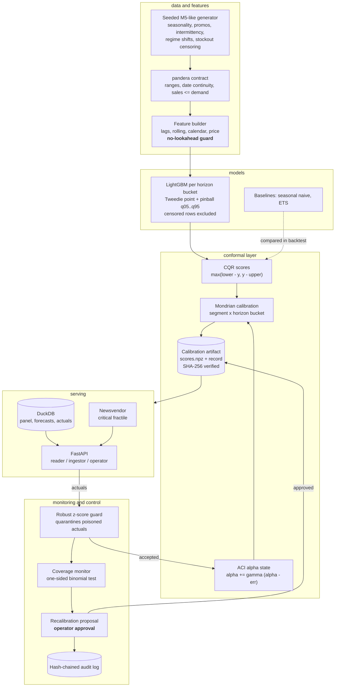

# conformal-demand-forecaster

Retail demand forecasts whose prediction intervals keep their promised coverage through regime
shifts, raise an alarm when coverage breaks, and turn intervals into order quantities.

A point forecast cannot size inventory. Quantile models can, until the demand regime moves —
a promotion calendar changes, a competitor closes, a category is re-priced — and then the bands
keep printing "95%" while covering 80%. Nothing in the stack notices, because a miscalibrated
interval looks exactly like a calibrated one.

This repository builds the interval as a first-class object with a guarantee attached:

- **conformalized quantile regression** over a global LightGBM model, so coverage is
  distribution-free and finite-sample rather than a property the optimizer happened to achieve;
- **Mondrian calibration** per (demand segment x horizon bucket), so the guarantee holds for
  intermittent slow movers and smooth fast movers separately instead of only on average;
- **Adaptive Conformal Inference**, which updates the effective miscoverage level online from
  realized errors, so a regime shift is absorbed in days instead of waiting for a retrain;
- **a binomial coverage monitor** that treats "within 2 points of nominal over 28 days" as an
  SLO and opens an **approval-gated** recalibration proposal when it breaks;
- **a newsvendor layer** that reads the order quantity off the conformalized quantiles, so the
  uncertainty actually reaches the decision.

Everything runs offline on CPU. The data comes from a seeded generator, the full evaluation takes
under four minutes, and no test, demo or benchmark calls a paid API.

## Architecture



Two loops run at different speeds. The **fast loop** is ACI: every day's realized misses nudge
the effective alpha for that group, which widens or narrows the next day's intervals. It is
bounded, automatic and reversible, and it changes no stored artifact. The **slow loop** is
recalibration: when the monitor's binomial test says coverage has genuinely broken, a proposal
is opened and an operator decides. Promoting a new calibration is the only irreversible action,
so it is the only one that needs a human ([ADR 0005](docs/adr/0005-approval-gated-recalibration.md)).

Layout:

```text
src/conformal_demand_forecaster/
  core/        settings, redacting logs, tracing, metrics, hardened FastAPI factory
  ml/          pandera contracts, run manifest, model registry, drift, safe serialization
  data/        seeded generator, wide-array panel
  features/    no-lookahead feature builder
  models/      LightGBM quantile models, seasonal-naive and ETS baselines
  conformal/   CQR scores, Mondrian calibrator, ACI state, versioned artifacts
  evaluation/  rolling-origin backtest, metrics, bench reporting
  decisions/   newsvendor order quantities
  monitoring/  coverage monitor, recalibration workflow, audit chain, metrics
  serving/     DuckDB store, forecasting runtime, role-based API, outlier guard
bench/         baseline, conformal, monitor, shift, backtest (all with thresholds)
tests/unit, tests/integration
docs/THREAT_MODEL.md  docs/adr/  CLAIMS.md  MODEL_CARD.md
```

## Quickstart

Requirements: [uv](https://docs.astral.sh/uv/) and Python 3.12.

```bash
uv sync --frozen
uv run python tasks.py demo    # the whole story offline, JSON summary on stdout
uv run python tasks.py check   # ruff, mypy --strict, pytest + coverage, bandit, pip-audit, baseline
uv run python tasks.py bench   # five benches with regression thresholds
```

On Windows, keep the environment off a small repository drive:
`$env:UV_PROJECT_ENVIRONMENT = "C:/Users/<you>/.venvs/conformal-demand-forecaster"`.

The demo generates 24 series with a level shift on a known day, trains and calibrates *before*
the shift, then streams every post-shift day in as actuals (one adversarial spike included) and
reports how the frozen and adaptive intervals held up:

```json
{
  "backtest_coverage_80_mondrian_pre_shift": 0.7991,
  "static_coverage_80_post_shift": 0.7815,
  "aci_coverage_80_post_shift": 0.8018,
  "static_scored_post_shift": 1680,
  "aci_scored_post_shift": 1680,
  "first_alarm_day_after_shift": 4,
  "quarantined_actuals": 3,
  "pending_proposals": ["d0834d5845594adeb5863d88ddac75a2", "6c761a8b52bd4109996914150c75e05f"],
  "audit_chain_ok": true,
  "seconds": 30.0
}
```

Frozen split conformal drifts to 78.2% coverage on a nominal 80% band; ACI holds 80.2%, both
measured over the same 1,680 one-step intervals. The monitor fires four days after the shift, the
injected spike is quarantined before it can move the calibration, and two proposals sit waiting
for an operator. The workdir is recreated on every run, so running the command again prints the
same numbers (only the proposal ids, the MLflow run id and the timing change).

Run the pipeline yourself:

```bash
uv run conformal-demand-forecaster generate --out var/panel.csv --n-series 200
uv run conformal-demand-forecaster train --panel var/panel.csv --data-dir var
uv run conformal-demand-forecaster backtest --panel var/panel.csv --n-origins 12
uv run conformal-demand-forecaster audit verify --data-dir var
```

Serve it. Keys are generated once and stored only as digests, one list per role:

```bash
uv run conformal-demand-forecaster generate-api-key     # prints the key and its SHA-256
APP_READER_KEY_SHA256=<digest> uv run conformal-demand-forecaster serve
curl -s -H "X-API-Key: <key>" "http://127.0.0.1:8000/v1/forecast/S0001_ST01?horizon=7"
```

```json
{
  "series_id": "S0001_ST01", "horizon": 7, "segment": "smooth",
  "point": 4.153, "median": 3.476,
  "intervals": {
    "80": {"lower": 0.304, "upper": 7.895,  "alpha_effective": 0.1394, "saturated": false},
    "95": {"lower": 0.0,   "upper": 12.349, "alpha_effective": 0.0360, "saturated": false}
  },
  "calibration_version": "3ccffd887904a283...",
  "model_version": "4aad8e2ad96a5e8b...",
  "order": {"fractile": 0.8, "fractile_served": 0.8, "fractile_clipped": false,
            "quantity": 6.790, "units": 7}
}
```

That response is the demo's `example_forecast` field, from the same `get_forecast` call the
route serves. `alpha_effective` is below its nominal 0.2 and 0.05 because ACI has widened this
group after the shift; `saturated` says whether the calibration set was exhausted, which is when
the guarantee stops being trustworthy. `fractile_clipped` says whether the cost ratio asked for a
quantile beyond the outermost calibrated one (above 39:1 here, which saturates at the 97.5%
bound), in which case `fractile_served` is the fractile the order was really read off. A forecast
is only meaningful as the pair `(model_version, calibration_version)`.

Containers: `docker compose up --build` runs the non-root, read-only image. The container build,
smoke test, trivy scan and SBOM are verified in CI (`.github/workflows/ci.yml`, job `docker`);
they were not run locally while building this repository.

## Results

All numbers below come from `bench/` scripts run on 2026-09-21 on Windows 10 (10.0.19045),
Intel64 Family 6 Model 158, 6 logical CPUs, Python 3.12.14, CPU only. Each command is named next
to its table; CI runs the same scripts against the looser limits in `bench/thresholds.json`.

### Accuracy and calibration

`uv run python bench/bench_backtest.py --series 200` — 200 series, 1096 days, 12 rolling origins,
28-day horizon, 67,200 rows scored against latent demand; 3m46s.

| model | MASE | weighted scaled pinball | coverage 80% | coverage 95% |
|---|---|---|---|---|
| **conformal GBM** | **0.8099** | **0.1901** | **0.7999** | **0.9532** |
| seasonal naive | 1.0487 | 0.2722 | 0.8055 | 0.8882 |
| ETS | 0.8891 | 0.2185 | 0.7768 | 0.8762 |

The conformalized bands land within 0.01 and 0.32 points of nominal. The baselines' bands are
empirical residual quantiles with no guarantee attached, and their 95% bands are six to seven
points short — which is exactly the failure this repository is about.

| level | method | coverage | width | Winkler | worst-segment gap |
|---|---|---|---|---|---|
| 80% | mondrian | 0.7999 | 17.05 | 24.55 | **0.0082** |
| 80% | pooled | 0.8004 | 16.75 | 24.54 | 0.0249 |
| 80% | aci | 0.7993 | 16.98 | 24.57 | 0.0021 |
| 80% | raw (no conformal step) | 0.7774 | 16.71 | 24.54 | 0.0397 |
| 95% | mondrian | 0.9532 | 24.66 | 35.67 | **0.0035** |
| 95% | pooled | 0.9532 | 24.35 | 35.56 | 0.0188 |
| 95% | aci | 0.9500 | 24.38 | 35.79 | 0.0007 |
| 95% | raw (no conformal step) | 0.9008 | 21.35 | 37.50 | 0.0607 |

`raw` is the same LightGBM quantile pair with no conformal step, which separates "the conformal
layer helped" from "the gradient-boosted model was already good". It is 2.3 points short at 80%
and 4.9 at 95%, with five to seventeen times the worst-segment gap; on the 20-series CI
configuration, where each group has fewer calibration points, it is 12.5 points short at 80%.

Pooled and Mondrian reach the same *average* coverage. The difference is the worst-segment gap:
pooled leaves 2.5 points of spread between smooth and intermittent series at 80%, Mondrian leaves
0.8, for about 2% more width ([ADR 0004](docs/adr/0004-mondrian-segment-horizon-groups.md)).

### Behaviour under a regime shift

`uv run python bench/bench_shift.py` — a model trained and frozen before a 2.2x level shift,
scored over the following 200 days without retraining or recalibrating; 2.7s.

| level | method | coverage before | coverage after | width after |
|---|---|---|---|---|
| 80% | frozen split conformal | 0.8411 | **0.6847** | 21.63 |
| 80% | ACI | 0.8214 | **0.7897** | 30.34 |
| 95% | frozen split conformal | 0.9409 | **0.8038** | 29.75 |
| 95% | ACI | 0.9381 | **0.9430** | 51.55 |

The frozen calibration ends 11.5 and 14.6 points below nominal. ACI holds to within 1.03 and
0.70 points, and pays for it with roughly 1.4x and 1.7x the width. The target this repository set
itself was a long-run coverage error below 1 point: met at 95% (0.70pp), missed by 0.03pp at 80%
in the shipped configuration. The shipped `gamma = 0.08` comes from the measured trade-off
(`--sweep`), not from taste ([ADR 0003](docs/adr/0003-adaptive-conformal-inference.md)).

### The coverage guarantee, in isolation

`uv run python bench/bench_conformal.py` — 500 independent exchangeable splits, 200 calibration
points each; 1.5s.

| level | measured coverage | lower bound | upper bound |
|---|---|---|---|
| 80% | 0.7960 | 0.7463 | 0.8586 |
| 95% | 0.9340 | 0.9208 | 0.9842 |

The bounds are `[1-alpha, 1-alpha + 1/(n+1)]` widened by a 3-sigma binomial tolerance for 500
splits. The same script isolates the Mondrian effect: with two groups whose noise differs by 6x,
pooled calibration covers them 0.878 and 0.760 (a 7.8-point gap around a nominal 0.80), while
per-group calibration gives 0.796 and 0.822 (2.2 points).

### Monitor operating characteristic

`uv run python bench/bench_monitor.py` — 500 stationary simulations, 500 breach simulations and
500 over-coverage simulations; 10.7s.

| metric | value |
|---|---|
| false alarms (share of stationary runs, 90 days each) | 0.004 |
| detection delay after a genuine breach, median | 9 days |
| detection delay, p90 | 12 days |
| breaches never detected inside the window | 0.000 |
| over-coverage false alarms (share of stationary runs) | 0.000 |
| over-coverage detection delay (miss rate 0.05 at nominal 0.20), median | 13 days |
| over-coverage never detected inside the window | 0.000 |

The second arm tests the other tail: bands that are systematically wider than their level asks
for are not a broken promise, but they are holding cost, and the newsvendor layer prices them.
Only a breach opens a recalibration proposal; over-coverage is reported and counted.

### Decisions

Ordering at holding cost 1 and stockout cost 4, same 200-series backtest:

| ordering policy | realized newsvendor cost |
|---|---|
| **conformalized quantiles** | **11.77** |
| point forecast | 14.43 |
| median forecast | 16.32 |

### Hot paths

`uv run python bench/bench_baseline.py` — microseconds per call, p95.

| benchmark | p50 (us) | p95 (us) |
|---|---:|---:|
| conformal_quantile_5k_scores | 31.3 | 35.7 |
| cqr_scores_5k_rows | 14.3 | 16.2 |
| newsvendor_orders_5k_rows | 207.8 | 219.9 |
| monitor_status_28_days | 148.1 | 191.1 |
| aci_update | 0.6 | 0.7 |
| outlier_guard_check | 106.4 | 129.9 |

These are single-machine numbers for spotting regressions, not performance claims.

## Security

Threats, controls and the tests that prove them are in
[docs/THREAT_MODEL.md](docs/THREAT_MODEL.md); every claim above and below maps to evidence in
[CLAIMS.md](CLAIMS.md).

The asset worth protecting is the **calibration**. A wrong model gives visibly wrong forecasts; a
wrong calibration gives intervals that still look authoritative while mis-sizing every order.

- **Role separation.** Three API-key roles — reader, ingestor, operator — each endpoint demands
  exactly one. A reader cannot ingest, an ingestor cannot read forecasts or decide, and an
  operator cannot ingest. Keys are stored only as SHA-256 digests and compared in constant time
  against every configured digest; protected routes fail closed when no keys are configured.
- **Approval-gated promotion.** A coverage alarm opens a proposal; only an operator can approve
  it and only an approved proposal can be applied. Every transition is appended to a hash-chained
  audit log naming the actor, the approver and both calibration versions. Editing or deleting an
  entry breaks the chain, and the writer refuses to append to a broken one. The proposal file is
  a projection of that chain, not the authority: before any transition the workflow replays the
  chain for that proposal and refuses when the two disagree, so editing the file cannot resurrect
  a rejected proposal or forge an approver.
- **Append-only history.** An ingested day is bounded to the window the service actually serves
  (panel start to the last observed day plus the forecast horizon) and rejected outside it, so a
  far-dated record cannot inflate the (series x day) panel or leave readiness looking green from
  an origin in the future. A day the panel already holds is never rewritten, never re-scored and
  audited as a duplicate: recorded sales are the guard's own reference window and, after a
  promotion, the calibration scores.
- **Poisoning resistance.** Ingested actuals pass the data contract, then a robust median/MAD
  guard with a Poisson-like floor anchored on the 90th percentile. Quarantined values are stored
  for review and never reach the ACI state, the monitor or the panel. The guard is one-sided, so
  a genuine collapse to zero still reaches the monitor, and one poisoned point in a series'
  history cannot disarm it — a mean/standard-deviation screen would wave the next spike straight
  through.
- **Artifact integrity.** The calibration version is the SHA-256 of its canonical record, which
  carries the digests of the score and reference files; all of them are verified on load, and an
  alpha state belonging to a different calibration is refused. Models are content-addressed in
  the registry. Nothing is pickled: LightGBM text, JSON and npz with `allow_pickle=False`. The
  alpha state is the one file outside that chain, so it fails closed on a step size the
  configuration did not choose.
- **No lookahead.** A feature row may read the panel only up to its origin, plus the target day's
  known-in-advance covariates. Tests perturb the future for arbitrary origins and horizons and
  assert every row is unchanged — a leak here would inflate accuracy and silently destroy the
  coverage guarantee.
- **Request hygiene.** Pattern-validated series ids, bounded horizons and costs, capped batch
  sizes, parameterised SQL, token-bucket rate limiting, body-size limits, security headers and
  strict CORS. Errors carry fixed codes and never echo exception text or submitted values; logs,
  tracebacks and audit payloads pass through PII and secret redaction. Contract violations report
  (column, check, count) without copying the rejected values.
- **No PII.** The panel holds SKU-store identifiers, units, prices and flags.
- **CI.** ruff, mypy --strict, pytest with an 85% coverage floor, bandit, semgrep with repo rules,
  pip-audit, gitleaks, hadolint, a trivy image scan and a syft CycloneDX SBOM. Base images are
  pinned by digest. See [SECURITY.md](SECURITY.md) for reporting.

## Non-goals

- **Per-series coverage.** The guarantee is marginal within a calibration group (segment x horizon
  bucket), not per SKU and not conditional on covariates. A single slow mover can be badly covered
  while its segment is fine. Closing this needs either per-series calibration — not enough scores
  per series at a 56-day window — or a conditional method such as localized conformal prediction.
- **Finite-sample guarantees under shift.** ACI's bound is long-run, says nothing about any given
  day, and its premise fails when the calibration set saturates. Saturated rows are flagged rather
  than hidden.
- **Real data.** The generator was written to contain the pathologies this design targets, so the
  measured improvements show the mechanism works, not what any real retailer's panel would give.
- **Automatic recalibration.** Deliberate: promotion is the one irreversible action, so it waits
  for an operator. ACI covers the gap in the meantime.
- **Weighted or localized conformal prediction.** The alternative to ACI under shift is to reweight
  calibration scores (Barber et al. 2023). It is discussed and rejected with reasons in
  [ADR 0003](docs/adr/0003-adaptive-conformal-inference.md), not implemented: it needs a weighting
  rule per group, and ACI reaches long-run coverage here with one measured parameter.
- **Acting on over-coverage.** The monitor reports its second arm and the newsvendor layer prices
  the width, but nothing narrows the bands automatically; that stays an operator's decision.
- **Tamper-proof audit.** The log is tamper-evident. Whoever can rewrite the whole file can
  rebuild the chain; publishing the head hash elsewhere would close that, and
  `audit verify --expect-head` exists for it.
- **Cold start.** No path for a SKU with no history, and no hierarchical or cross-series pooling
  for new items.
- **Censored-likelihood modelling.** Stockout days are excluded from training and calibration
  rather than modelled as censored observations.
- **Distributed anything.** Rate-limit buckets are per process; audit, proposal and artifact
  writes coordinate through local file locks that assume a local filesystem.
- **Key rotation or user identity.** One static API-key scheme per role; no JWT, OIDC or rotation.
- **An MLflow server or signed model provenance.** MLflow is used on its local file backend as a
  run log only (upstream has it in maintenance mode); the run manifest is the authoritative
  reproducibility record, and the registry is a local content-addressed store.
- **Exporting telemetry.** Traces go to the console or nowhere; OTLP export is left to deployment.
